# 1. 产品介绍

## 1.1 产品安全

本产品含细小零件，请避免儿童独自接触。

请严格按照教程操作，避免产品损坏，注意用电安全。

## 1.2 产品概述

本教程面向 **KT0378 传感器扩展包** 与 **KT0379 木板造型扩展包**，两者均为小智AI聊天机器人系列套件设计的配套功能扩展组件，配合小智AI聊天机器人主控板使用。

**KT0378 传感器扩展包**：套件包含10种常用的传感器与执行器模块，配合小智AI聊天机器人主控板，可实现声、光、电、温度、气体检测、距离测量、运动控制等多种交互功能。每个模块均采用2.54mm间距排针接口，通过杜邦线即可轻松连接，无需焊接，适合创客学习和AI应用开发。

**KT0379 木板造型扩展包**：套件包含木板造型件及配套电子模块，可搭建旋转彩灯（音乐盒）、环境监测、自动浇水、智能垃圾桶共4个造型扩展项目，每个项目均通过语音（"你好小智"唤醒）控制，代码基于KidsBlock图形化编程。

本教程共包含14个项目：第5章为KT0378传感器扩展包的10个项目，第6章为KT0379木板造型扩展包的4个造型项目。每个项目独立成章，从模块介绍、接线方法到代码示例、运行效果，循序渐进地引导用户完成每个模块的学习与使用。所有代码均基于KidsBlock图形化编程环境，拖拽积木即可完成程序编写，适合青少年及初学者快速上手。

## 1.3 传感器扩展包清单（KT0378）

| 硬件名称 | 主要用途 | 数量 | 图片 |
| --- | --- | --- | --- |
| 白色LED模块 | 数字输出，高电平点亮 | 1 |  |
| 6812 RGB模块 | 单总线控制，可编程全彩显示 | 1 | 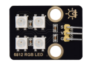 |
| 水泵驱动模块 | 控制驱动水泵抽水 | 1 | 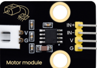 |
| 光敏电阻传感器 | 模拟输出，检测环境光强度 | 1 | 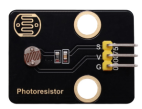 |
| 声音传感器 | 模拟输出，检测声音强度 | 1 |  |
| 水滴传感器 | 模拟输出，检测湿度/水滴 | 1 | 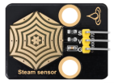 |
| LM35温度传感器 | 模拟输出，检测环境温度 | 1 | 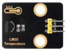 |
| MQ-5液化气传感器 | 模拟输出，检测液化气/煤气 | 1 | 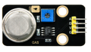 |
| 9G舵机 | PWM控制，0~180°旋转 | 1 | 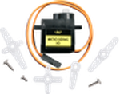 |
| HC-SR04超声波传感器 | 测距3~400cm | 1 | 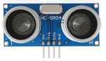 |
| 8002b功放 喇叭模块      | 播放音乐                   | 1    | 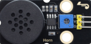 |
| 电容式土壤湿度传感器    | 测量土壤湿度               | 1    | 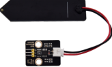 |
| ULN2003电机驱动板       | 驱动步进电机               | 1    |  |
| 28BYJ-48 4相5线步进电机 | DC:5V 步进电机             | 1    |  |
| 浇花小水泵 | 抽水 | 1 | 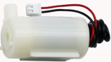 |
| 浇花水管 | 连接水泵引水 | 1 |  |
| 3P杜邦线 | 3针模块与开发板之间的连接 | 3 | 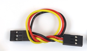 |
| 4P杜邦线 | 4针模块与开发板之间的连接 | 2 | 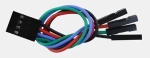 |
| XH-2.54转杜邦线（4P） | 移动版本主板专用转接线 | 2 | 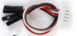 |
| XH-2.54转杜邦线（3P） | 移动版本主板专用转接线 | 3 |  |
| 母对母杜邦线 | 步进电机驱动模块连接主板 | 1 | 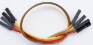 |

## 1.4 木板造型扩展包清单（KT0379）

| 序号 | 物料名称 | 数量 | 图片 |
| --- | --- | --- | --- |
| 1 | 吸塑盒 | 2 |  |
| 2 | 尼龙铆钉（R4060 按压式，R型，白色） | 16 |  |
| 3 | 尼龙铆钉（R3090 按压式，R型，白色） | 16 |  |
| 4 | 螺钉（M1.4*10MM 圆头十字，304不锈钢） | 5 | 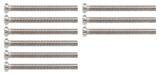 |
| 5 | 螺母（M1.4 镀镍） | 5 | 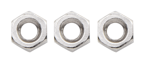 |
| 6 | 螺母（M2 镀镍） | 3 |  |
| 7 | 螺钉（M2*12MM 圆头十字） | 3 | 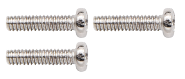 |
| 8 | 自攻螺钉（M1.2*4MM 圆头十字，自攻） | 5 | 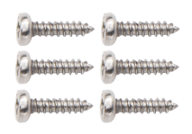 |
| 9 | 螺钉（M2*10MM 圆头十字） | 2 |  |
| 10 | 椴木板（小智AI聊天机器人 4款造型扩展包，椴木本色，T=3MM，环保） | 1 |  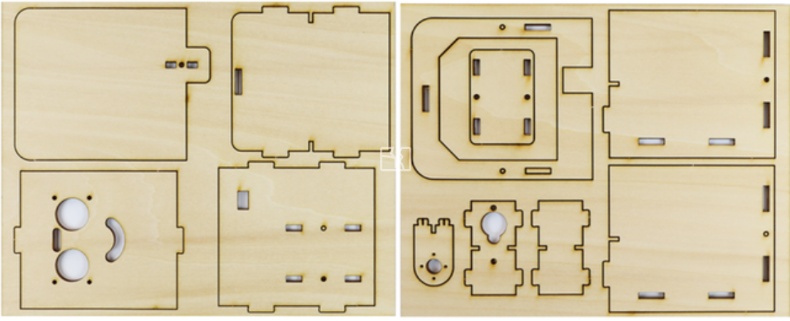  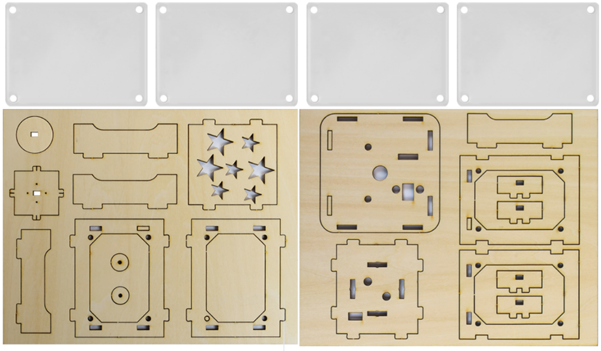 |
| 11 | 螺丝刀（3*40MM 十字螺丝刀，手柄黄黑） | 1 |  |
