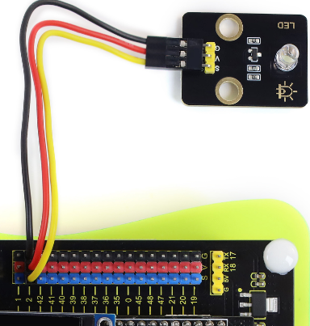
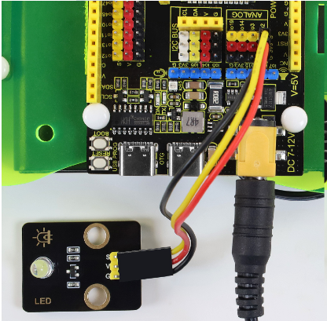
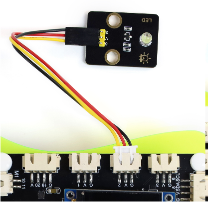
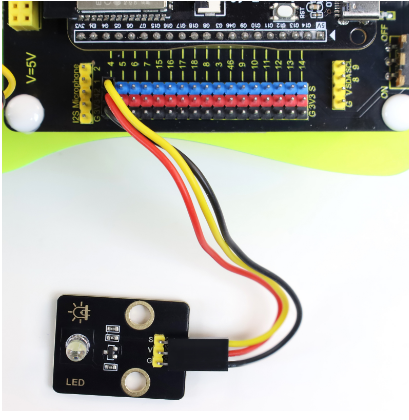
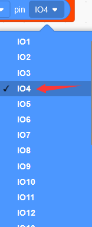

# 2. 产品接口

## 2.1 传感器扩展包接口（KT0378）

本教程所有3针模块默认使用 **GPIO 2**，4针模块默认使用 **GPIO 8 和 GPIO 9**（暂作为普通数字端口）。由于多个模块共用同一端口，**不能同时使用**，需要分时插接或自行更换引脚。

> 接线说明：**mini / pro / rover** 主板按默认 **GPIO 2** 接线；**cam 摄像头版本**改接 **GPIO 4**（GPIO 2 已被麦克风占用），代码中所有 IO2 改为 IO4。

**接口速查表**

| 传感器/模块 | GPIO引脚 | 引脚功能 |
| --- | --- | --- |
| 白色LED模块 | GPIO 2 | 数字输出 |
| 6812 RGB模块 | GPIO 2 | 单总线数据 |
| 水泵驱动模块 | GPIO 8, GPIO 9 | IN1, IN2 |
| 光敏电阻传感器 | GPIO 2 | ADC模拟输入 |
| 声音传感器 | GPIO 2 | ADC模拟输入 |
| 水滴传感器 | GPIO 2 | ADC模拟输入 |
| LM35温度传感器 | GPIO 2 | ADC模拟输入 |
| MQ-2模拟气体传感器 | GPIO 9 | ADC模拟输入 |
| 9G舵机 | GPIO 2（rover主板接GPIO14） | PWM输出 |
| HC-SR04超声波 | GPIO 8, GPIO 9 | TRIG, ECHO |
| 步进电机模块 | GPIO 8, GPIO 9, GPIO 13（rover接GPIO48）, GPIO 14 | IN1, IN2, IN3, IN4 |
| 蜂鸣器模块 | GPIO 2 | 数字输出 |
| 土壤湿度传感器 | GPIO 2 | ADC模拟输入 |

### 接线示例

**基础版本**

---

**升级版本**

---

**移动版本**

> 移动版本主板的部分模块接口采用 XH-2.54 端子，套件中已配备专用的 XH-2.54 转杜邦线（4P 和 3P），方便直接连接超声波、光敏等模块。
---

**摄像头版本**

> 摄像头版本注意事项：该版本 GPIO 2 已被麦克风占用，3针传感器信号线请改接至 GPIO 4，并在代码中将所有 IO2 改为 IO4。我们已提供修改后的完整代码，您只需按此接线即可正常使用。

**鼓励自行扩展**：以上端口为教程默认配置，方便初学者快速上手。掌握基本用法后，欢迎自行更换GPIO引脚进行扩展开发——套件配备的散拼杜邦线可自由接入开发板任意端口，实现更多模块的组合使用。

## 2.2 木板造型扩展包接口（KT0379）

下表汇总自木板造型项目教程（第6章）中各项目的硬件连接：

| 造型项目 | 模块 | 引脚 | 说明 |
| --- | --- | --- | --- |
| 旋转彩灯 | WS2812 RGB模块 | IO10(rover接GPIO2) | 4颗灯珠 |
| 旋转彩灯 | 有源蜂鸣器 | IO3 | 播放提示音和音乐 |
| 旋转彩灯 | 步进电机 IN1 | IO8 | 28BYJ-48驱动 |
| 旋转彩灯 | 步进电机 IN2 | IO9 | 28BYJ-48驱动 |
| 旋转彩灯 | 步进电机 IN3 | IO13(rover接GPIO48) | 28BYJ-48驱动 |
| 旋转彩灯 | 步进电机 IN4 | IO14 | 28BYJ-48驱动 |
| 环境监测 | 热敏电阻（温度） | IO2(cam主板接IO15) | 模拟量输入 |
| 环境监测 | 光敏电阻（光线） | IO3(cam主板接IO16) | 模拟量输入 |
| 环境监测 | 气体传感器（空气） | IO9 | 模拟量输入 |
| 自动浇水 | 水泵驱动 IN1 | IO8 | 电机驱动 |
| 自动浇水 | 水泵驱动 IN2 | IO9 | 电机驱动 |
| 自动浇水 | 土壤湿度传感器 | IO3 | 模拟量输入 |
| 智能垃圾桶 | 舵机 | IO14 | 开盖120°，关盖10° |
| 智能垃圾桶 | 超声波 Trig | IO8 | 触发 |
| 智能垃圾桶 | 超声波 Echo | IO9 | 回响 |

> 说明：各造型项目为独立示例，若在同一主控板上依次搭建不同项目，请按对应章节的接线表重新接线。
