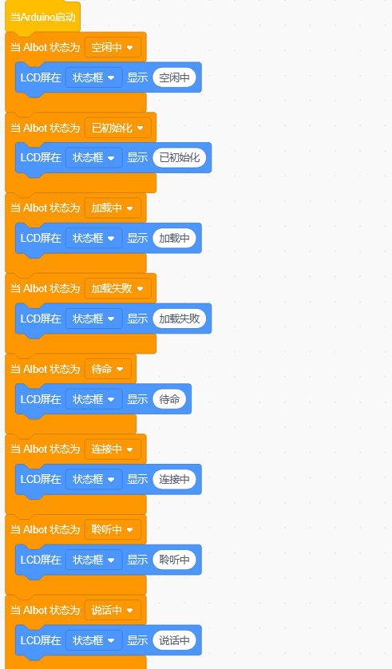
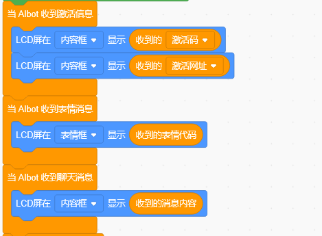

# 3. 基础框架说明

以下代码是所有模块项目共用的基础框架，在每个项目代码中都存在，用于初始化硬件、连接网络、注册语音服务等。为简化教程篇幅，后续项目将不再重复解释这部分内容。

## 1. 硬件初始化

启动时，程序会依次完成以下初始化工作：

- **I2S 麦克风初始化**：配置麦克风的时钟和数据引脚，用于采集用户语音
- **I2S 扬声器初始化**：配置扬声器的时钟和数据引脚，用于播放AI回复的语音
- **LCD屏幕初始化**：配置屏幕的SPI引脚（背光、MOSI、CLK、DC、RST、CS），用于显示设备状态和对话内容

## 2. WiFi连接与配网

设备启动后会自动尝试连接已保存的WiFi网络：
- **连接成功**：设备播报"网络已连接"语音提示，进入待命状态
- **连接失败**：设备进入AP配网模式，手机可搜索到名为`KEYES-AI-XXXX`的热点,连接热点后，手机通常会自动弹出**KEYES WIFI配置**页面。若未弹出，请手动打开浏览器并访问 http://192.168.4.1

详细可参考主板流程http://192.168.4.1

## 3. 注册MCP服务

每个项目需要向小智AI服务器注册当前模块对应的MCP工具，注册内容包括：

- **服务名**：当前模块对应的功能名称
- **描述**：该功能的作用说明
- **参数**：执行该功能需要的参数名称和类型

注册完成后，用户可通过语音指令调用这些工具，实现语音控制。

## 4. 启动AI引擎

程序配置小智AI后台地址后启动引擎，设置语言、音量。设备进入待命状态，等待用户说"小智小智/你好小智"唤醒。

## 5. LCD屏幕状态显示

设备运行过程中，LCD屏幕会实时同步显示当前状态：

| 设备状态 | LCD显示内容 |
| --- | --- |
| WiFi连接中 | 连接中 |
| WiFi连接成功 | 网络已连接 |
| 服务器连接中 | 加载中 |
| 服务器连接失败 | 加载失败 |
| 待命（等待唤醒） | 待命 |
| 唤醒/录音中 | 聆听中 |
| AI回复/播放音频 | 说话中 |

## 6. 公共事件回调

| 触发事件 | LCD显示内容 |
| --- | --- |
| 收到激活码 | 内容框显示6位验证码 |
| 收到表情消息 | 表情框显示表情代码 |
| 收到聊天消息 | 内容框显示消息内容 |

