# 5. 传感器扩展项目教程

## 项目1：白色LED模块

### 1. 描述

白色LED模块是电子制作中最基础的输出元件之一。LED（发光二极管）是一种能将电能转化为光能的半导体器件，具有功耗低、寿命长、响应速度快等优点，被广泛应用于指示灯、显示屏背光、照明等领域。

本模块采用高亮度白色LED，信号端（S）为高电平时LED点亮，低电平时LED熄灭。用户可通过语音指令"打开LED"和"关闭LED"控制LED的亮灭，理解数字输出与语音控制的基本概念。

### 2. 规格参数

| 参数 | 规格 |
| --- | --- |
| 工作电压 | DC 3V3 / 5V |
| 接口类型 | 间距为2.54mm的防反接口 |
| 功耗 | 约20mA（在5V工作时） |

### 3. 组件清单

| 组件 | 数量 |
| --- | --- |
| 小智AI聊天机器人主控板 | 1 |
| 白色LED模块 | 1 |
| 3P杜邦线 | 1 |

### 4. 接线图

> 接线说明：表中标注 **GPIO 2** 的信号线，**mini / pro / rover** 主板接 **GPIO 2**；**cam 摄像头版本**改接 **GPIO 4**（GPIO 2 已被麦克风占用），代码中所有 IO2 改为 IO4。

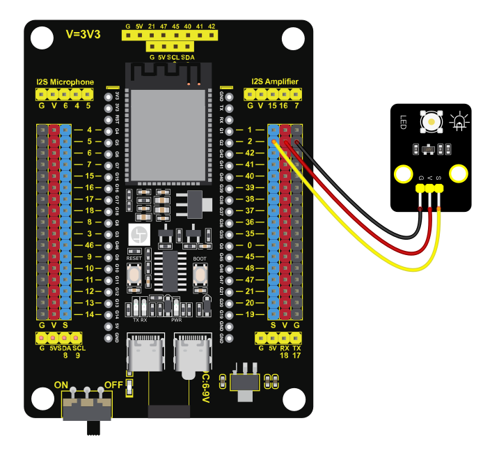

| **白色LED模块** | **开发板** |
| --- | --- |
| G | GND |
| V | 3V3 / 5V |
| S | **GPIO 2** |

### 5. 积木代码

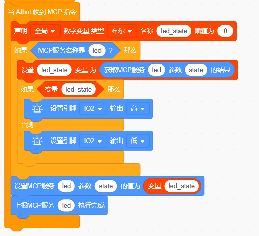

### 6. 代码讲解

本项目的核心是通过GPIO数字输出控制LED的点亮与熄灭。

① 注册MCP服务：程序向小智AI服务器注册一个工具。

② 设置控制参数：该工具接收一个布尔类型的参数 state。

state 为 true 时表示"打开"，false 时表示"关闭"。

③ 执行控制：当服务器调用该工具时，程序从参数中取出 state 值。

④ 输出控制信号：根据 state 值控制GPIO 2输出高电平或低电平，实现LED的点亮和熄灭。

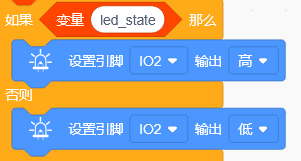

⑤ 返回执行结果：向服务器返回执行成功的结果。

### 7. 测试结果

> 说明：先点一下开发板上的 BOOT 键，界面显示“聆听中”即进入对话模式，此时可用语音与小智对话。

与小智AI对话：
- "小智，打开LED" → LED点亮
- "小智，关闭LED" → LED熄灭

白色LED模块可通过语音指令控制点亮和熄灭，响应迅速，状态切换准确。

### 8. 扩展实践

尝试通过修改代码，让LED在点亮后延时5秒自动熄灭，实现"定时关灯"功能。

## 项目2：6812 RGB模块

### 1. 描述

6812 RGB模块是一款集成了SK6812智能控制芯片的全彩LED模块。与传统RGB模块需要多个引脚分别控制红、绿、蓝不同，6812 RGB模块采用单总线通信方式，仅需一根信号线即可实现每个LED的独立颜色和亮度控制。每颗LED内部集成了控制电路与发光芯片，支持256级亮度调节，可组合显示多达16777216种颜色。

本模块适用于各种彩色灯光效果场景，如氛围灯、流水灯、呼吸灯等。用户可通过语音指令切换不同灯光效果，理解单总线通信与PWM控制的基本原理。

### 2. 规格参数

| 参数 | 规格 |
| --- | --- |
| LED类型 | SMD 5050 RGB |
| 工作电压 | DC 3V3 / 5V |
| 最大功率 | 1W |
| IC型号 | 4颗/WS2811 |
| 灰度等级 | 256级 |
| 发光角度 | 180° |
| 工作温度 | -10℃ 到 +50℃ |
| 功耗 | 约20mA（在5V工作时） |

### 3. 组件清单

| 组件 | 数量 |
| --- | --- |
| 小智AI聊天机器人主控板 | 1 |
| 6812 RGB模块 | 1 |
| 3P杜邦线 | 1 |

### 4. 接线图

> 接线说明：表中标注 **GPIO 2** 的信号线，**mini / pro / rover** 主板接 **GPIO 2**；**cam 摄像头版本**改接 **GPIO 4**（GPIO 2 已被麦克风占用），代码中所有 IO2 改为 IO4。

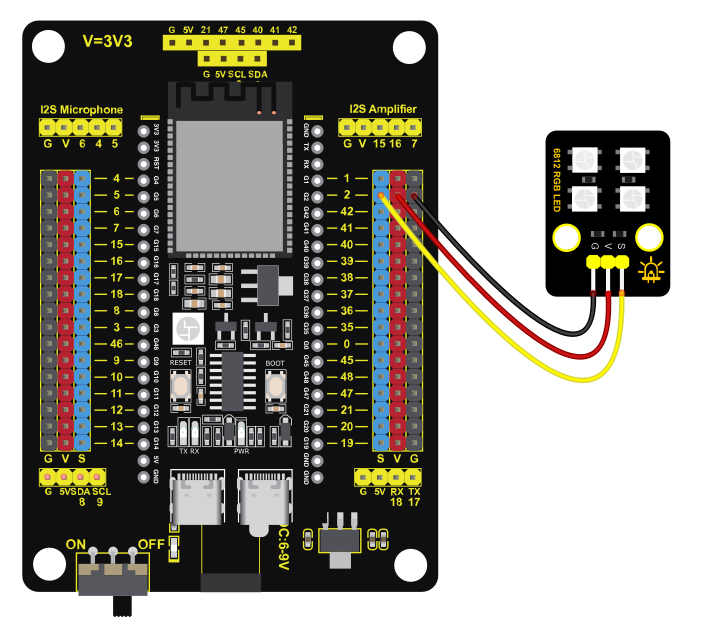

| **6812 RGB模块** | **开发板** |
| --- | --- |
| G | GND |
| V | 3V3 / 5V |
| S | **GPIO 2** |

### 5. 积木代码

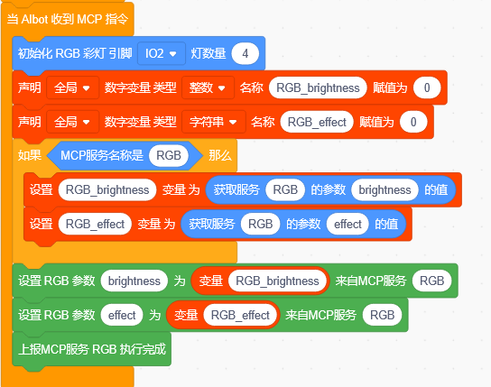

### 6. 代码讲解

本项目的核心是通过单总线通信控制RGB彩灯显示不同灯光效果。

① 初始化RGB彩灯：设置控制引脚和灯珠数量。

② 创建变量：创建两个全局变量，用来存放语音指令传过来的数据。

brightness 存亮度（0~255），effect_name 存效果名称（如"彩虹"）。

③ 注册MCP服务：注册一个名为 RGB 的工具，让语音助手能识别这个功能。

服务名填 RGB，参数 brightness（数值）和 effect（字符串）。注册之后，用户的语音指令才能被服务器识别并转发给设备。

④ 接收MCP指令：用户发出语音指令后，服务器会调用 rgb 工具，传回 brightness 和 effect 两个参数。

判断服务名是否为 RGB，是则取出 brightness 和 effect 存入变量。

⑤ 执行灯光效果：将变量的值传给RGB灯，执行对应的灯光效果。

判断 effect_name 的值，执行对应的效果分支。

⑥ 上报执行结果：灯光效果执行完成后，向服务器上报"执行完成"。

### 7. 测试结果

> 说明：先点一下开发板上的 BOOT 键，界面显示“聆听中”即进入对话模式，此时可用语音与小智对话。

与小智AI对话：
- "小智，彩虹模式" → 彩虹效果
- "小智，呼吸灯" → 呼吸效果
- "小智，闪烁模式" → 闪烁效果
- "小智，流水灯" → 流水效果
- "小智，关灯" → 关闭RGB

6812 RGB模块按照语音指令切换不同动画效果，颜色过渡平滑，动画运行流畅。

### 8. 扩展实践

尝试在代码中添加新的灯光效果，如"双色渐变"或"随机闪烁"。

## 项目3：水泵驱动模块+浇花水泵

### 1. 描述

浇花水泵是一款静音迷你潜水泵（型号 JT-DC3W-3），具备 IP68 防水等级，可直接放入水中使用，配合土壤湿度传感器可组成智能浇花系统。通电后，水泵即可将水从低处抽到高处，为植物自动浇水。

本模块通过两个 GPIO 控制水泵的开关和转速：一个引脚控制开关，另一个引脚输出 PWM 信号调速。用户可通过语音指令控制水泵的启动和停止，理解 PWM 调速的基本原理。

### 2. 规格参数

| 参数 | 规格 |
| --- | --- |
| 产品类型 | 浇花水泵（静音迷你潜水泵） |
| 型号 | JT-DC3W-3 |
| 电流 | 0.12A |
| 工作电压 | DC 3V-5V |
| 功率 | 0.36W |
| 扬程 | 0.35M |
| 流量 | 80 L/H |
| 启动电压 | 1V |
| 防水等级 | IP68 |

### 3. 组件清单

| 组件 | 数量 |
| --- | --- |
| 小智AI聊天机器人主控板 | 1 |
| 浇花水泵 | 1 |
| 水泵驱动模块           | 1    |
| 4P杜邦线 | 1 |

### 4. 接线图

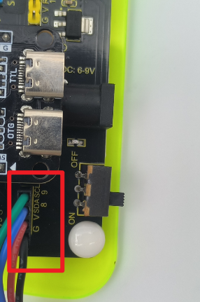

| **水泵驱动模块** | **开发板** |
| --- | --- |
| IN1 | **GPIO 8** |
| IN2 | **GPIO 9** |
| V | 3V3 / 5V |
| G | GND |

### 5. 积木代码

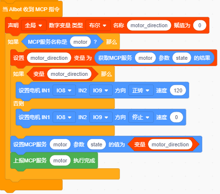

### 6. 代码讲解

本项目的核心是通过GPIO控制水泵的启动与停止。

① 注册MCP服务：程序向服务器注册一个工具。

② 设置控制参数：该工具接收一个布尔类型参数，state用于打开和关闭水泵。

③ 创建变量：创建变量存储水泵状态值。

④ 判断开关：当 变量为真时，打开水泵，为假时关闭。

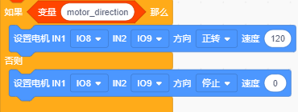

> **注意**：本套件使用4节或6节5号电池供电，无法驱动大功率水泵，仅作演示使用，若需更大动力，可自行更换高倍率放电电池（请确保电压一致）。

### 7. 测试结果

> 说明：先点一下开发板上的 BOOT 键，界面显示“聆听中”即进入对话模式，此时可用语音与小智对话。

与小智AI对话：
- "小智，打开水泵" → 水泵启动
- "小智，关闭水泵" → 水泵停止

浇花水泵可按语音指令实现启动和停止，PWM值越大转速越快。

### 8. 扩展实践

尝试在代码中添加PWM调速功能，并通过语音指令调节水泵转速。

## 项目4：光敏电阻传感器

### 1. 描述

光敏电阻传感器是一种利用半导体光敏元件的光电导效应工作的传感器。其核心元件是光敏电阻，一种特殊的电阻器，其阻值随入射光强度的变化而变化。光线越强，光敏电阻的阻值越低，输出的电压越高；光线越暗，阻值越高，输出电压越低。

本模块将光敏电阻与固定电阻组成分压电路，将光强变化转化为电压信号输出（模拟量）。通过ESP32的ADC引脚读取这个电压信号，可以量化检测环境光强度。用户可通过语音指令查询当前光线强度，理解模拟信号采集与ADC转换的基本原理。

### 2. 规格参数

| 参数 | 规格 |
| --- | --- |
| 传感器类型 | 光敏电阻 |
| 工作电压 | 3V3 / 5V |
| 光敏范围 | 2-20KΩ（受光照强度影响） |
| 功耗 | 约20mA（在5V工作时） |

### 3. 组件清单

| 组件 | 数量 |
| --- | --- |
| 小智AI聊天机器人主控板 | 1 |
| 光敏电阻传感器 | 1 |
| 3P杜邦线 | 1 |

### 4. 接线图

> 接线说明：表中标注 **GPIO 2** 的信号线，**mini / pro / rover** 主板接 **GPIO 2**；**cam 摄像头版本**改接 **GPIO 4**（GPIO 2 已被麦克风占用），代码中所有 IO2 改为 IO4。

| **光敏电阻传感器** | **开发板** |
| --- | --- |
| G | GND |
| V | 3V3 / 5V |
| S | **GPIO 2**（ADC引脚） |

### 5. 积木代码

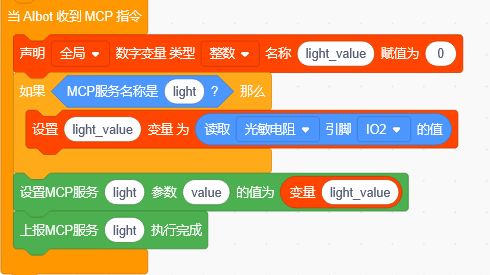

### 6. 代码讲解

本项目的核心是通过ADC读取光敏传感器的模拟电压值，获取环境光强度。

① 注册MCP服务：程序向服务器注册一个工具。

该工具无输入参数，返回当前光线强度值（0~4095）。

② 创建变量：创建变量用于存储读取到的光线值。

③ 读取模拟值：当服务器调用该工具时，程序通过ADC读取GPIO 2的模拟值。

光线越强数值越大，光线越暗数值越小。

④ 返回结果：读取完成后将数值返回给服务器播报。

### 7. 测试结果

> 说明：先点一下开发板上的 BOOT 键，界面显示“聆听中”即进入对话模式，此时可用语音与小智对话。

与小智AI对话：
- "小智，读取光线强度" → 播报当前光线强度值

用手遮挡光敏电阻传感器或改变环境光强度，语音查询时会播报不同的光线数值。

### 8. 扩展实践

结合白色LED模块制作"智能感应灯"——当环境光低于设定阈值时自动点亮LED。

## 项目5：声音传感器

### 1. 描述

声音传感器是一种将声音信号转换为电信号的声学传感器。其核心元件是麦克风（MIC），能够拾取环境中的声音并将其转化为微弱的电压信号，再经过内部放大电路处理后输出可被微控制器读取的模拟电压信号。声音越大，输出的电压越高，ADC读数越大；声音越小，输出电压越低。

本模块适用于声控开关、音量检测、语音触发等交互场景。用户可通过语音指令查询当前声音强度，理解声音信号采集与放大电路的基本原理。

### 2. 规格参数

| 参数 | 规格 |
| --- | --- |
| 传感器类型 | 声音传感器 |
| 工作电压 | DC 3V3 / 5V |
| 检测频率 | 7-20KHz |
| 功耗 | 约20mA（在5V工作时） |

### 3. 组件清单

| 组件 | 数量 |
| --- | --- |
| 小智AI聊天机器人主控板 | 1 |
| 声音传感器 | 1 |
| 3P杜邦线 | 1 |

### 4. 接线图

> 接线说明：表中标注 **GPIO 2** 的信号线，**mini / pro / rover** 主板接 **GPIO 2**；**cam 摄像头版本**改接 **GPIO 4**（GPIO 2 已被麦克风占用），代码中所有 IO2 改为 IO4。

| **声音传感器** | **开发板** |
| --- | --- |
| G | GND |
| V | 3V3 / 5V |
| S | **GPIO 2**（ADC引脚） |

### 5. 积木代码

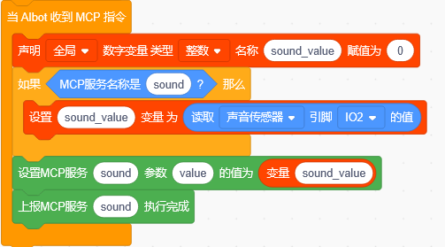

### 6. 代码讲解

本项目的核心是通过ADC读取声音传感器的模拟电压值，获取声音强度。

① 注册MCP服务：程序向服务器注册一个工具。

该工具无输入参数，返回当前声音强度值（0 ~ 4095）。

② 创建变量：创建变量用于存储读取到的声音值。

③ 读取模拟值：当服务器调用该工具时，程序通过ADC读取GPIO 2的模拟值。

安静时数值较低（约100 ~ 300），说话或拍手时数值明显升高（500 ~ 2000+）。

④ 返回结果：读取完成后将数值返回给服务器播报。

### 7. 测试结果

> 说明：先点一下开发板上的 BOOT 键，界面显示“聆听中”即进入对话模式，此时可用语音与小智对话。

与小智AI对话：
- "小智，读取声音强度" → 播报当前声音强度值

对着声音传感器说话或拍手，语音查询时会播报不同的声音强度数值。

### 8. 扩展实践

配合白色LED模块制作"声控灯"——检测到声音时LED闪烁或点亮。

## 项目6：水滴传感器

### 1. 描述

水滴传感器是一种利用PCB走线间的电阻变化来检测湿度或水分的传感器。其检测区域由两条交错的铜箔走线组成，当传感器表面干燥时，两条走线之间的电阻极大，输出电压接近供电电压；当有水滴滴落在检测区域时，水会导通两条走线之间的间隙，导致电阻下降，输出电压随之降低。水滴越多，电阻越小，输出电压越低。

本模块适用于雨水检测、漏液监测、溢水报警等场景。用户可通过语音指令查询当前是否检测到水滴，理解电阻式传感器与分压电路的基本原理。

### 2. 规格参数

| 参数 | 规格 |
| --- | --- |
| 传感器类型 | 水滴传感器 |
| 工作电压 | DC 3V3 / 5V |
| 功耗 | 约20mA（在5V工作时） |

### 3. 组件清单

| 组件 | 数量 |
| --- | --- |
| 小智AI聊天机器人主控板 | 1 |
| 水滴传感器 | 1 |
| 3P杜邦线 | 1 |

### 4. 接线图

> 接线说明：表中标注 **GPIO 2** 的信号线，**mini / pro / rover** 主板接 **GPIO 2**；**cam 摄像头版本**改接 **GPIO 4**（GPIO 2 已被麦克风占用），代码中所有 IO2 改为 IO4。

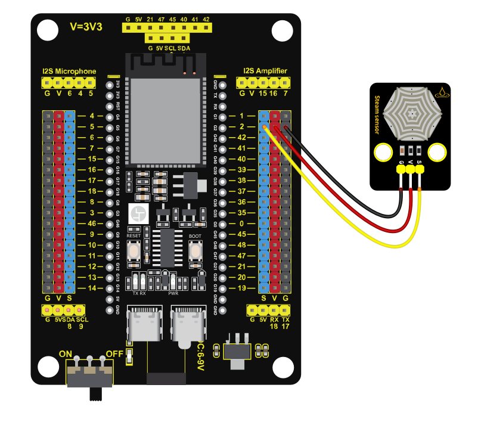

| **水滴传感器** | **开发板** |
| --- | --- |
| G | GND |
| V | 3V3 / 5V |
| S | **GPIO 2**（ADC引脚） |

### 5. 积木代码

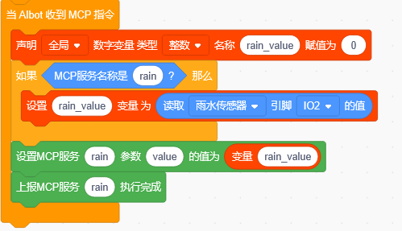

### 6. 代码讲解

本项目的核心是通过ADC读取水滴传感器的模拟电压值，检测是否有水。

① 注册MCP服务：程序向服务器注册一个工具。

该工具无输入参数，返回当前湿度检测值（0 ~ 4095）。

② 创建变量：创建变量用于存储读取到的湿度值。

③ 读取模拟值：当服务器调用该工具时，程序通过ADC读取GPIO 2的模拟值。

传感器干燥时数值较高（3000 ~ 4095），有水滴时数值明显下降（500 ~ 2000），完全浸水时数值接近0。这是因为水导通了两条走线间的电阻，导致输出电压下降。

④ 返回结果：读取完成后将数值返回给服务器播报。

### 7. 测试结果

> 说明：先点一下开发板上的 BOOT 键，界面显示“聆听中”即进入对话模式，此时可用语音与小智对话。

与小智AI对话：
- "小智，检测是否有水" → 播报当前水滴传感器状态

用滴管滴一滴水到水滴传感器的检测区域，语音查询时会播报明显变化的数值。

### 8. 扩展实践

结合语音播报功能制作"下雨报警器"——检测到水滴时主动触发语音提示。

## 项目7：LM35温度传感器

### 1. 描述

LM35温度传感器是一款高精度线性温度传感器，其输出电压与摄氏温度成正比，转换系数为10mV/℃。这意味着当温度升高1℃时，输出电压增加10mV。例如，25℃时输出电压为250mV，100℃时输出电压为1000mV。LM35具有测量精度高、线性度好、成本低等优点，测量范围覆盖-55℃至+150℃。

本模块广泛应用于环境温度监测、智能温控系统、电子体温计等领域。用户可通过语音指令查询当前环境温度，理解模拟传感器的数据采集与数值换算方法。

### 2. 规格参数

| 参数 | 规格 |
| --- | --- |
| 传感器类型 | LM35温度传感器 |
| 工作电压 | DC 3V3 / 5V |
| 温度范围 | -55℃ 到 +150℃ |
| 输出电压 | 10mV/℃ |
| 功耗 | 约60µA（在5V工作时） |

### 3. 组件清单

| 组件 | 数量 |
| --- | --- |
| 小智AI聊天机器人主控板 | 1 |
| LM35温度传感器 | 1 |
| 3P杜邦线 | 1 |

### 4. 接线图

> 接线说明：表中标注 **GPIO 2** 的信号线，**mini / pro / rover** 主板接 **GPIO 2**；**cam 摄像头版本**改接 **GPIO 4**（GPIO 2 已被麦克风占用），代码中所有 IO2 改为 IO4。

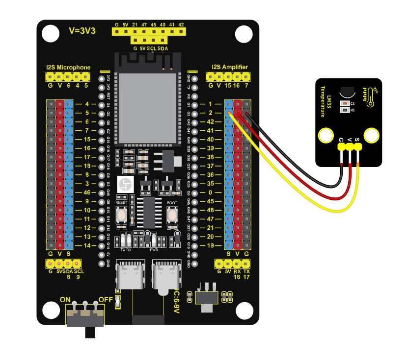

| **LM35温度传感器** | **开发板** |
| --- | --- |
| G | GND |
| V | 3V3 / 5V |
| S | **GPIO 2**（ADC引脚） |

### 5. 积木代码

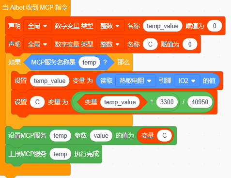

### 6. 代码讲解

本项目的核心是通过ADC读取LM35温度传感器的模拟电压值，并通过公式换算为实际温度。

① 注册MCP服务：程序向服务器注册一个工具。

该工具无输入参数，返回当前温度值（放大10倍的整数，如253表示25.3℃）。

② 创建变量：创建变量存储原始ADC值。

③ 存储温度结果：创建变量存储换算后的温度值。

④ 读取模拟值：当服务器调用该工具时，程序通过ADC读取GPIO 2的模拟值。

⑤ 换算温度：将ADC值换算为温度，公式为 温度 = ADC值 × 3300 / 40950。

例如ADC值为310时，温度 = 310 × 3300 / 40950 ≈ 25℃，与实际室温相符。

⑥ 返回结果：将温度值返回给服务器播报。

### 7. 测试结果

> 说明：先点一下开发板上的 BOOT 键，界面显示“聆听中”即进入对话模式，此时可用语音与小智对话。

与小智AI对话：
- "小智，当前温度是多少" → 播报当前温度值

常温下语音播报室温数值（约20~30℃），用手捏住LM35温度传感器，温度值逐渐上升。

### 8. 扩展实践

在LCD屏幕上实时显示当前温度值，并每隔一定时间自动更新。

## 项目8：MQ-2气体传感器

### 1. 描述
Keyes MQ-2气体传感器是一款半导体式可燃气体检测传感器，对甲烷、液化气（LPG）、煤气等多种可燃气体具有较高的灵敏度。其工作原理基于二氧化锡（SnO2）半导体材料在接触可燃气体时电阻发生变化的特性。当空气中存在可燃气体时，传感器的电导率会随气体浓度升高而增大，通过分压电路可将这种变化转换为电压信号输出。

MQ-2具有响应速度快、寿命长、成本低等优点，广泛应用于燃气泄漏报警器、气体检测仪、智能家居安防系统等场景。使用前需预热1~2分钟使传感器内部的加热丝达到稳定工作温度。用户可通过语音指令查询当前气体浓度，理解半导体气体传感器的基本原理。

### 2. 规格参数

| 参数 | 规格 |
|------|------|
| 传感器类型 | MQ-2气体传感器 |
| 工作电压 | DC 3V3 / 5V |
| 检测气体 | 甲烷（CH4）、液化气（LPG）、煤气等 |
| 功耗 | 约150mA（在5V工作时，含加热丝） |

### 3. 组件清单

| 组件 | 数量 |
|------|------|
| 小智AI聊天机器人主控板 | 1 |
| MQ-2气体传感器 | 1 |
| 4P杜邦线 | 1 |

### 4. 接线图

| **MQ-2气体传感器** | **开发板** |
| --- | --- |
| G | GND |
| V | 3v/5V |
| D | **GPIO 8**（未使用） |
| A | **GPIO 9**（ADC引脚） |

> MQ-2气体传感器预热1~2分钟后读数才稳定。

### 5. 积木代码

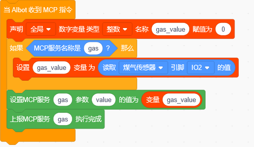

### 6. 代码讲解

本项目的核心是通过ADC读取MQ-2气体传感器的模拟电压值，判断可燃气体浓度。

① 注册MCP服务：程序向服务器注册一个工具。

该工具无输入参数，返回当前气体浓度值（0~4095）。

② 创建变量：创建变量用于存储读取到的气体浓度值。

③ 读取模拟值：当服务器调用该工具时，程序通过ADC读取GPIO 2的模拟值。

正常情况下数值相对稳定（约100 ~ 200），当检测到可燃气体时数值快速上升（可达2000 ~ 3000+），浓度越高数值越大。这是因为半导体材料接触气体后电阻减小，分压输出电压升高。

④ 返回结果：读取完成后将数值返回给服务器播报。

### 7. 测试结果

> 说明：先点一下开发板上的 BOOT 键，界面显示“聆听中”即进入对话模式，此时可用语音与小智对话。

与小智AI对话：
- "小智，检测燃气泄漏" → 播报当前燃气浓度值

将打火机气体靠近MQ-2气体传感器（不点燃），语音查询时会播报明显升高的数值。

### 8. 扩展实践

设置报警阈值，当检测值超过阈值时触发语音提示"检测到燃气泄漏，请注意安全！"

## 项目9：9G舵机

### 1. 描述

9G舵机是一种微型伺服电机，通过PWM（脉宽调制）信号精确控制输出轴的旋转角度。舵机内部集成了直流电机、减速齿轮组、位置反馈电位器和控制电路，构成一个闭环控制系统。控制电路接收PWM信号的脉宽宽度（通常为0.5ms ~ 2.5ms），与电位器反馈的当前位置进行比较，驱动电机旋转到目标角度并保持在该位置，角度范围通常为0° ~ 180°。

9G舵机体积小、重量轻、扭矩适中，广泛应用于机器人关节、摄像头云台、机械臂、玩具模型等场景。用户可通过语音指令控制舵机旋转到指定角度，理解PWM信号与伺服控制的基本原理。

### 2. 规格参数

| 参数 | 规格 |
| --- | --- |
| 类型 | 9G微型伺服舵机 |
| 工作电压 | DC 3.3V ~ 6V |
| 角度范围 | 0° ~ 180° |
| 扭矩 | 约1.5~2.0Kg·cm（在5V时） |
| 控制信号 | PWM（周期20ms，脉宽0.5ms~2.5ms） |

### 3. 组件清单

| 组件 | 数量 |
| --- | --- |
| 小智AI聊天机器人主控板 | 1 |
| 9G舵机 | 1 |
| 3P杜邦线 | 1 |

### 4. 接线图

> 接线说明：表中标注 **GPIO 2** 的信号线，**mini / pro / rover** 主板接 **GPIO 2**；**cam 摄像头版本**改接 **GPIO 4**（GPIO 2 已被麦克风占用），代码中所有 IO2 改为 IO4。

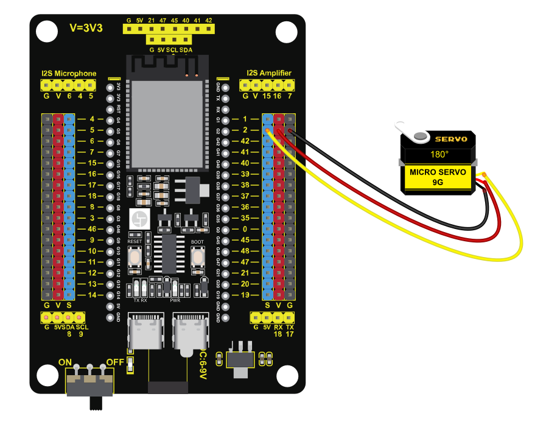

| **9G舵机** | **开发板** |
| --- | --- |
| 棕色（GND） | GND |
| 红色（VCC） | 3V3 / 5V |
| 橙色（SIG） | **GPIO 2**（PWM引脚） |

⚠️ 接线提示：
本教程演示以基础版本（GPIO 2）为准。如果您使用的是移动版本（带XH2.54接口），舵机自带线材请接至 GPIO 14。代码已为您适配好移动版本，无需手动修改引脚，直接使用即可。

### 5. 积木代码

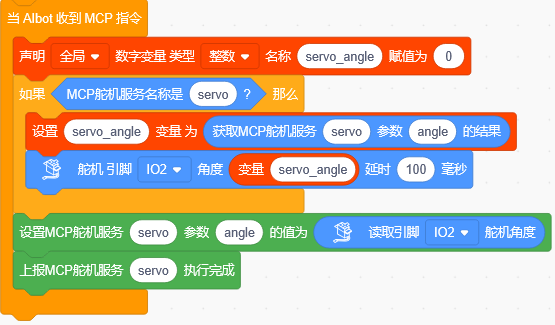

### 6. 代码讲解

本项目的核心是通过PWM信号控制舵机旋转到指定角度。

① 注册MCP服务：程序向服务器注册一个工具。

该工具接收 angle（角度0~180）参数。

② 创建变量：创建变量用于存储语音指令传递的角度值。

③ 获取参数：当服务器调用该工具时，程序从参数中取出 angle 值。

④ 输出PWM信号：将角度值存入变量后，控制GPIO 2输出对应的PWM信号，舵机旋转到指定角度。

⑤ 读取当前角度：执行完成后，读取当前舵机角度。

### 7. 测试结果

> 说明：先点一下开发板上的 BOOT 键，界面显示“聆听中”即进入对话模式，此时可用语音与小智对话。

与小智AI对话：
- "小智，舵机转到90度" → 舵机转到指定角度
- "小智，舵机归零" → 舵机回到0度

9G舵机按语音指令准确转动到指定角度，位置定位精确。

### 8. 扩展实践

用9G舵机带动HC-SR04超声波传感器来回摆动，实现"智能扫描雷达"效果。

## 项目10：HC-SR04超声波传感器

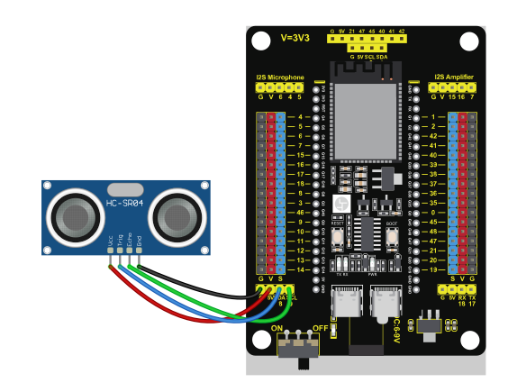

### 1. 描述

HC-SR04超声波传感器是一种常用的非接触式测距传感器，通过发射超声波并接收回波来测量与障碍物之间的距离。其工作原理与蝙蝠的回声定位类似：传感器先通过TRIG引脚发射一束超声波（频率40kHz），超声波遇到障碍物后反射回来，被ECHO引脚接收。通过测量从发射到接收的时间差，结合声波在空气中的传播速度（约340m/s），即可计算出传感器与障碍物之间的距离。

超声波测距具有响应快、成本低、不受环境光影响等优点，测量范围通常为3~400cm，广泛应用于智能小车避障、倒车雷达、无人机定高、智能垃圾桶等场景。用户可通过语音指令查询当前障碍物距离，理解超声波的发射与接收测距原理。

### 2. 规格参数

| 参数 | 规格 |
| --- | --- |
| 传感器类型 | HC-SR04超声波传感器 |
| 工作电压 | DC 3.3V ~ 5V |
| 测量范围 | 3 ~ 400cm |
| 测量精度 | 约3mm |
| 超声波频率 | 40kHz |

### 3. 组件清单

| 组件 | 数量 |
| --- | --- |
| 小智AI聊天机器人主控板 | 1 |
| HC-SR04超声波传感器 | 1 |
| 4P杜邦线 | 1 |

### 4. 接线图

| **HC-SR04超声波传感器** | **开发板** |
| --- | --- |
| VCC | 3V3 / 5V |
| GND | GND |
| TRIG | **GPIO 8** |
| ECHO | **GPIO 9** |

### 5. 积木代码

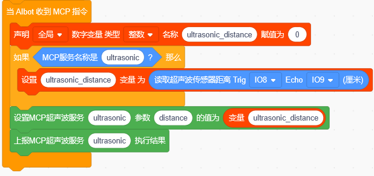

### 6. 代码讲解

本项目的核心是通过超声波传感器测量与障碍物之间的距离。

① 注册MCP服务：程序向服务器注册一个工具。

该工具无输入参数，返回当前距离值（0 ~ 400cm）。

② 创建变量：创建变量用于存储测量到的距离值。

③ 读取距离值：当服务器调用该工具时，程序读取超声波传感器的距离值。

超声波测距的原理是发射声波并接收回波，通过计算时间差换算为距离。

④ 返回结果：读取完成后将距离值返回给服务器播报。

### 7. 测试结果

> 说明：先点一下开发板上的 BOOT 键，界面显示“聆听中”即进入对话模式，此时可用语音与小智对话。

与小智AI对话：
- "小智，测量距离" → 播报当前障碍物距离值

串口实时显示HC-SR04超声波传感器与障碍物之间的距离，语音查询时播报当前距离值。

### 8. 扩展实践

结合9G舵机（项目9），用舵机带动HC-SR04超声波传感器左右扫描，测量多个方向的距离。

## 项目11：步进电机驱动模块

### 1. 描述

步进电机是一种将电脉冲信号转换为角位移的电机。每收到一个脉冲，电机就转动一个固定的角度（步距角），脉冲数决定转角，脉冲频率决定转速，因此可以精确控制转动角度和圈数，广泛应用于3D打印机、机械臂、云台等需要精确定位的场景。

本模块采用28BYJ-48步进电机与ULN2003驱动板，通过4个GPIO引脚（IN1~IN4）控制。用户可通过语音指令控制电机正转、反转和停止，理解步进电机驱动与脉冲控制的原理。

### 2. 规格参数

| 参数 | 规格 |
| --- | --- |
| 电机类型 | 28BYJ-48 步进电机 |
| 工作电压 | DC 5V |
| 步距角 | 5.625°（1/64 减速后约 0.088°） |
| 减速比 | 1:64 |
| 驱动板 | ULN2003 |

### 3. 组件清单

| 组件 | 数量 |
| --- | --- |
| 小智AI聊天机器人主控板 | 1 |
| 28BYJ-48 步进电机 | 1 |
| ULN2003 驱动板 | 1 |
| 6P 杜邦线 | 1 |

### 4. 接线图

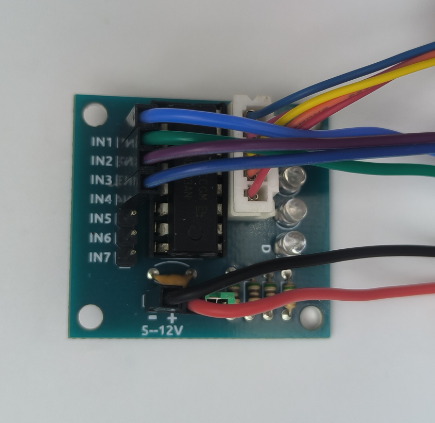

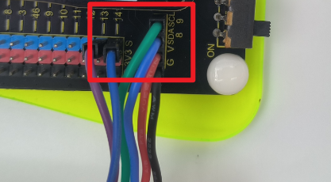

| **步进电机驱动板** | **开发板** |
| --- | --- |
| IN1 | **GPIO 8** |
| IN2 | **GPIO 9** |
| IN3 | **GPIO 13** |
| IN4 | **GPIO 14** |
| VCC | 5V |
| GND | GND |

### 5. 积木代码

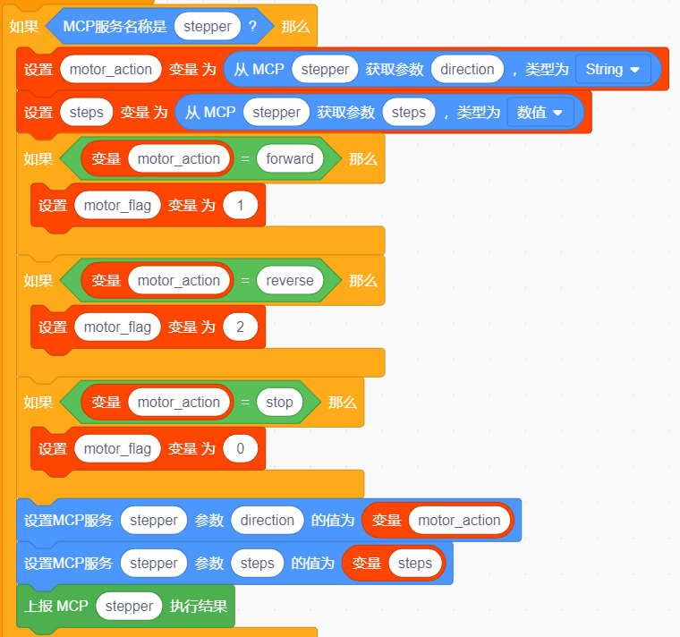

### 6. 代码讲解

本项目的核心是通过4个GPIO按顺序输出脉冲信号，驱动步进电机转动。

① 注册MCP服务：程序向服务器注册一个工具。

该工具接收 direction 参数（forward / stop / reverse）。

② 设置引脚：将 IO8、IO9、IO13、IO14 设置为输出，分别对应驱动板的 IN1~IN4。

③ 正转：按 IN1→IN2→IN3→IN4 的顺序依次输出脉冲，电机正转。

④ 反转：按相反顺序输出脉冲，电机反转。

⑤ 停止：停止输出脉冲，电机停转。

> **注意**：步进电机请使用非阻塞的 `micros()` 定时驱动（参考第6章6.1旋转氛围灯项目），不要使用 `delay()`，否则语音会卡顿。经过1:64减速后，28BYJ-48 约需 4096 步转一圈。

### 7. 测试结果

> 说明：先点一下开发板上的 BOOT 键，界面显示“聆听中”即进入对话模式，此时可用语音与小智对话。

与小智AI对话：
- "小智，步进电机正转2048步" → 步进电机正转半圈
- "小智，步进电机反转4096步" → 步进电机反转一圈
- "小智，电机停止" → 电机停止

### 8. 扩展实践

尝试通过修改代码，让电机正转一圈后自动反转一圈，实现往复摆动。

## 项目12：蜂鸣器模块

### 1. 描述

蜂鸣器是一种一体化结构的电子讯响器，分为有源蜂鸣器和无源蜂鸣器两种。本模块采用有源蜂鸣器，内部自带振荡源，通电即可发声，只需一个GPIO引脚控制高电平发声、低电平停止，常用于提示音、报警音和简单的音乐播放。

用户可通过语音指令控制蜂鸣器发声与停止，理解数字输出控制音频元件的基本方法。

### 2. 规格参数

| 参数 | 规格 |
| --- | --- |
| 蜂鸣器类型 | 有源蜂鸣器（自带振荡源） |
| 工作电压 | DC 3V3 / 5V |
| 接口类型 | 间距为2.54mm的防反接口 |

### 3. 组件清单

| 组件 | 数量 |
| --- | --- |
| 小智AI聊天机器人主控板 | 1 |
| 蜂鸣器模块 | 1 |
| 3P杜邦线 | 1 |

### 4. 接线图

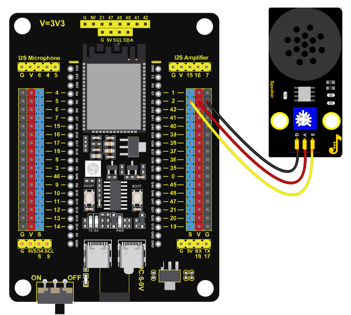

| **蜂鸣器模块** | **开发板** |
| --- | --- |
| G | GND |
| V | 3V3 / 5V |
| S | **GPIO 2** |

> 接线说明：表中标注 **GPIO 2** 的信号线，**mini / pro / rover** 主板接 **GPIO 2**；**cam 摄像头版本**改接 **GPIO 4**（GPIO 2 已被麦克风占用），代码中所有 IO2 改为 IO4。

### 5. 积木代码

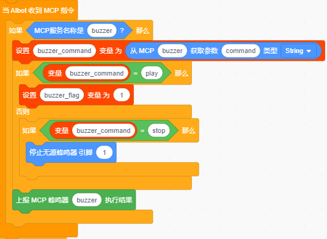

### 6. 代码讲解

本项目的核心是通过GPIO数字输出控制蜂鸣器发声。

① 注册MCP服务：程序向服务器注册一个工具。

② 设置控制参数：该工具接收一个字符类型的参数 command。

③ 输出控制信号：command为 play时播放音乐；command为 stop时，蜂鸣器停止。

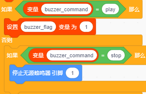

### 7. 测试结果

> 说明：先点一下开发板上的 BOOT 键，界面显示“聆听中”即进入对话模式，此时可用语音与小智对话。

与小智AI对话：
- "小智，设置蜂鸣器播放音乐" → 蜂鸣器播放音乐
- "小智，关闭蜂鸣器" → 蜂鸣器停止

### 8. 扩展实践

尝试通过修改代码，让蜂鸣器播放不同的音乐。

## 项目13：土壤湿度传感器

### 1. 描述

土壤湿度传感器通过检测土壤的导电率来判断含水量：土壤越湿润，导电率越高，输出的模拟电压越低；土壤越干燥，输出的电压越高。常用于自动浇花、农业种植等场景。

本模块输出模拟量信号，用户可通过语音询问土壤干湿程度，理解模拟量采集与数据换算的基本方法。

### 2. 规格参数

| 参数 | 规格 |
| --- | --- |
| 传感器类型 | 土壤湿度传感器（探头 + 信号模块） |
| 工作电压 | DC 3V3 / 5V |
| 输出信号 | 模拟量（AO） |
| 接口类型 | 间距为2.54mm的防反接口 |

### 3. 组件清单

| 组件 | 数量 |
| --- | --- |
| 小智AI聊天机器人主控板 | 1 |
| 土壤湿度传感器 | 1 |
| 4P杜邦线 | 1 |

### 4. 接线图

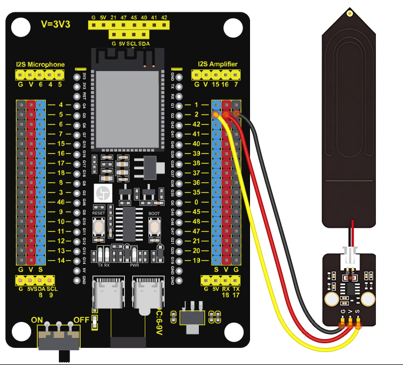

| **土壤湿度传感器** | **开发板** |
| --- | --- |
| G | GND |
| V | 3V3 / 5V |
| AO | **GPIO 2**（ADC引脚） |

> 接线说明：表中标注 **GPIO 2** 的信号线，**mini / pro / rover** 主板接 **GPIO 2**；**cam 摄像头版本**改接 **GPIO 4**（GPIO 2 已被麦克风占用），代码中所有 IO2 改为 IO4。

### 5. 积木代码

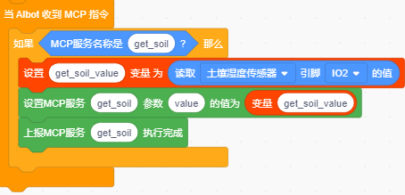

### 6. 代码讲解

本项目的核心是通过ADC读取土壤湿度传感器的模拟值，并换算为湿度百分比。

① 注册MCP服务：程序向服务器注册一个工具。

② 读取模拟值：当服务器调用该工具时，程序通过ADC读取GPIO 2的模拟值。

### 7. 测试结果

> 说明：先点一下开发板上的 BOOT 键，界面显示“聆听中”即进入对话模式，此时可用语音与小智对话。

与小智AI对话：
- "小智，土壤湿度多少" → 播报当前土壤湿度

### 8. 扩展实践

结合浇花水泵（项目3），实现"土壤干燥时自动浇水"的智能浇花系统。

> **扩展学习**：完成上述13个项目后，可以尝试将多个传感器组合使用——例如用9G舵机带动HC-SR04超声波传感器扫描测距、用光敏电阻传感器控制白色LED模块亮度、用声音传感器触发语音交互等。
